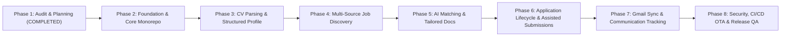

# JOBPILOT INTERNATIONAL — MASTER IMPLEMENTATION PLAN

> **Project**: JobPilot International  
> **Official Remote**: `https://github.com/frechfanta-os/JOBPILOT`  
> **Application Package ID**: `com.ghdinteractivestudio.jobpilot`  
> **Methodology**: Replica Skills Framework (`recon`, `architect`, `design`, `build`, `backend`, `test`, `diff`, `brand`, `deploy`)  
> **Current Phase**: Phase 2 Complete (Foundation & Monorepo Scaffolding)  
> **Status**: Milestone 1 Validated (Flutter & Backend Green) — Awaiting Phase 3 Authorization  
> **Timestamp**: 2026-10-11T15:05:00Z  

---

## 1. Roadmap & Phase Overview

---

## 2. Integration Milestones (1 through 8)

### Milestone 1 — Architectural Foundation & Monorepo Scaffolding
- **Objective**: Establish the dual codebase (`app/` Flutter and `backend/` Cloudflare Worker), initialize Git tracking on `frechfanta-os/JOBPILOT`, configure CI/CD quality gates, and verify local build tools.
- **Replica Skills Applied**: `replica-architect`, `replica-design`.
- **Target Deliverables**:
  - Initialized `/root/JOBPILOT` monorepo with `app/` and `backend/`.
  - Android package configured as `com.ghdinteractivestudio.jobpilot`.
  - Cloudflare Worker TypeScript project configured with `wrangler.toml` and D1/R2 bindings.
  - Initial D1 migration (`0001_initial_schema.sql`) checked in.
  - GitHub Actions CI workflow for Flutter analysis, tests, and Worker linting.
- **Measurable Acceptance Criteria**:
  - `flutter analyze` passes with zero warnings.
  - `npm run test` executes successfully against D1 local mock.
  - Initial commit pushed cleanly to `frechfanta-os/JOBPILOT`.
  - CI pipeline passes on GitHub Actions.

### Milestone 2 — Personal Profile & Job Discovery (End-to-End Slice)
- **Objective**: Implement CV upload (PDF), text extraction, structured profile editing, live job search across Canadian and Italian official sources, and display on Android.
- **Replica Skills Applied**: `replica-recon`, `replica-build`.
- **Target Deliverables**:
  - Flutter screens: Profile Screen (`S01`), CV Upload (`S02`), Job Discovery Feed (`S03`).
  - Backend endpoints: `POST /api/v1/documents/cv/upload`, `GET /api/v1/jobs/search`.
  - Connectors: Job Bank Canada RSS/Open Data parser, Adzuna (CA & IT) connector.
  - Deduplication pipeline based on job content hash.
- **Measurable Acceptance Criteria**:
  - User can pick a PDF from Android storage, upload to Worker, extract text, and view populated profile.
  - Real job search retrieves active listings for Canada (CAD) and Italy (EUR).
  - Empty, loading, and error states visually validated on Flutter UI.

### Milestone 3 — AI-Powered Matching & Tailored Document Generation
- **Objective**: Compute explainable match scores between real jobs and the candidate profile, highlighting gaps and drafting tailored CVs and cover letters.
- **Replica Skills Applied**: `replica-backend`, `replica-build`.
- **Target Deliverables**:
  - OpenRouter AI integration with prompt injection defenses.
  - Match assessment calculation returning 0–100 score, criteria breakdown, and risk notes.
  - Job Match Screen (`S04`) and Tailored Document Editor (`S05`).
  - Document export endpoint producing job-specific PDF/Markdown drafts.
- **Measurable Acceptance Criteria**:
  - Match assessment output strictly follows JSON schema without hallucinated qualifications.
  - Tailored cover letter accurately references real candidate experiences and target job title.
  - Generated documents remain in draft mode until explicit user approval.

### Milestone 4 — Application Lifecycle Management
- **Objective**: Track application states from discovery to completion, maintaining document associations and preventing duplicates.
- **Replica Skills Applied**: `replica-build`, `replica-architect`.
- **Target Deliverables**:
  - State machine enforcing valid transitions: `DISCOVERED` -> `ANALYZED` -> `READY_FOR_REVIEW` -> `APPROVED` -> `SUBMISSION_PENDING` -> `SUBMITTED` -> `CLOSED`.
  - Applications Dashboard (`S06`) with filtering by state and country.
  - Unique constraint verification on `(user_id, job_id)` in D1.
- **Measurable Acceptance Criteria**:
  - Impossible to create duplicate applications for the same job listing.
  - State transitions audit-logged with timestamps and correlation IDs.

### Milestone 5 — Authorized Gmail Communication Tracking
- **Objective**: Enable secure, read-only Gmail integration via Google OAuth 2.0 PKCE to detect recruiter correspondence.
- **Replica Skills Applied**: `replica-backend`, `replica-test`.
- **Target Deliverables**:
  - Google OAuth 2.0 PKCE flow in Flutter client.
  - Cloudflare Worker backend token exchange and AES-GCM encrypted storage.
  - Background email parser identifying confirmations, interview invitations, rejections, and offers.
  - Email Communications Screen (`S07`).
- **Measurable Acceptance Criteria**:
  - Scopes restricted strictly to `gmail.readonly`.
  - Zero Gmail passwords or unencrypted tokens stored.
  - Recruiter interview invitations correctly classified and surfaced on user dashboard.

### Milestone 6 — Controlled & Assisted Submission Engine
- **Objective**: Implement authorized application submission adapters and user-assisted submission packets.
- **Replica Skills Applied**: `replica-build`, `replica-backend`.
- **Target Deliverables**:
  - User-assisted submission flow: prepares deep link, pre-fills cover letter on clipboard, presents candidate checklist.
  - Official API submission adapters (where permitted and authenticated).
  - Mandatory human approval gate (`POST /applications/:id/approve`) prior to any transmission.
  - Global and per-user emergency kill switch in Cloudflare KV.
- **Measurable Acceptance Criteria**:
  - Automated submissions disabled by default.
  - Submissions require explicit user confirmation.
  - Idempotency key prevents duplicate network dispatches.

### Milestone 7 — Follow-Up Tracking, Deadlines & Alerts
- **Objective**: Provide automated reminders for pending applications, schedule follow-ups, and track recruiter response metrics.
- **Replica Skills Applied**: `replica-build`, `replica-test`.
- **Target Deliverables**:
  - Local Android notifications for interview dates and recommended follow-up windows.
  - Pre-drafted polite follow-up messages adhering to Canadian and Italian business norms.
  - Analytics view on Dashboard displaying application conversion rates.
- **Measurable Acceptance Criteria**:
  - Reminders trigger locally without requiring unpermitted background battery drains.
  - Follow-up draft generation requires user review before copying or sending.

### Milestone 8 — End-to-End QA, OTA Pipeline & Release Readiness
- **Objective**: Execute comprehensive testing, accessibility audits, security verification, and produce release APKs.
- **Replica Skills Applied**: `replica-test`, `replica-diff`, `replica-deploy`.
- **Target Deliverables**:
  - Full test suite: unit tests, widget tests, and backend integration tests.
  - `replica/test-plan.md` executed with zero open `S1` or `S2` defects.
  - WCAG AA contrast check passed across all screens via `contrast.py`.
  - GitHub Actions APK release workflow producing signed release APK, versioned APK, and SHA-256 checksums matching the validated CimentFlow OTA standard.
- **Measurable Acceptance Criteria**:
  - Release APK verified via `aapt dump badging` for correct package name (`com.ghdinteractivestudio.jobpilot`).
  - SHA-256 checksum recorded in release notes.
  - In-app OTA update service configured and verified.

---

## 3. Governance and Phase Transition Gate

**STRICT PHASE 1 BOUNDARY**:  
Execution of Phase 2 (Foundation & Core Monorepo) will commence **only after explicit user authorization**. No files outside Phase 1 planning documents have been generated.

---

*Master Implementation Plan established and locked.*
