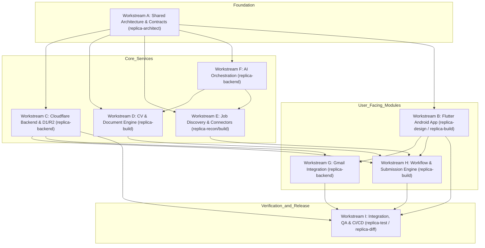

# JOBPILOT INTERNATIONAL — PARALLEL DEVELOPMENT PLAN

> **Methodology**: Replica Skills Framework (`recon`, `architect`, `design`, `build`, `backend`, `test`, `diff`)  
> **Target Project**: JobPilot International  
> **Package Identifier**: `com.ghdinteractivestudio.jobpilot`  
> **Author / Role**: Principal Software Architect & Technical Project Coordinator  
> **Status**: Completed Phase 1 Planning Document  
> **Timestamp**: 2026-10-11T14:34:00Z  

---

## 1. Architecture Overview & Execution Strategy

JobPilot International is structured as a modular system split cleanly between an **Android Mobile Client (Flutter)** and a **Cloudflare Serverless Backend (Workers, D1, R2, Queues)**.

To enable parallel execution across multiple autonomous agents or sequential execution by a single agent without merge conflicts or architectural divergence:
1. **Contract-First Stability**: All shared data models, API endpoints, schema definitions, and error conventions must be frozen in `MODULE_CONTRACTS.md` prior to any code generation.
2. **Strict File Ownership**: Each workstream operates within isolated directories. Shared files (such as `MODULE_CONTRACTS.md` or global configurations) require formal review before changes.
3. **Replica Methodology Enforcement**: Every stage of implementation adheres strictly to the validated `SKILL.md` instructions from `/root/.gemini/replica-skill/`.

---

## 2. Dependency Graph & Workstream Relationships

---

## 3. Workstream Specifications (A through I)

### Workstream A: Shared Architecture, Domain Models & Security Contracts
- **Scope & Responsibilities**: Maintain unified domain entities, API schemas, application lifecycle state machines, error formats, and security rules.
- **Replica Skills**: `replica-architect`, `replica-recon`.
- **Files Owned**: `MODULE_CONTRACTS.md`, `INITIAL_THREAT_MODEL.md`, `shared/types/` (TypeScript), `app/lib/core/domain/` (Dart models).
- **Shared Files Restricted**: Modifies global contracts only upon consensus; locks interfaces for other workstreams.
- **Dependencies**: None. First to execute and freeze.
- **Parallel Status**: Independent. Must reach Milestone 1 before parallel coding begins.
- **Acceptance Criteria**: All 9 entities and 9 lifecycle states formalised with zero ambiguous data types.

### Workstream B: Flutter Android Application (Presentation & Navigation)
- **Scope & Responsibilities**: Mobile client UI/UX, Material 3 design system, responsive layouts for phones/tablets, GoRouter navigation, Riverpod state management, offline Hive/SQLite caching.
- **Replica Skills**: `replica-design`, `replica-build`.
- **Files Owned**: `app/lib/presentation/`, `app/lib/core/theme/`, `app/lib/core/router/`, `app/test/widget/`.
- **Shared Files Restricted**: Must not directly modify backend schemas or external API client interfaces.
- **Dependencies**: Workstream A (contracts), Workstream D (mock models), Workstream E (mock job feeds).
- **Parallel Status**: Runs in parallel with Backend (C, D, E) using mocked contract data.
- **Acceptance Criteria**: 100% of screens (S01–S09) render with all 5 states (empty, loading, filled, error, offline); WCAG AA contrast compliance verified.

### Workstream C: Cloudflare Backend (Workers API, D1 Schema & R2 Storage)
- **Scope & Responsibilities**: Cloudflare Worker REST API, D1 SQLite database migrations, R2 bucket storage operations, JWT session verification, server-side rate limiting.
- **Replica Skills**: `replica-backend`, `replica-architect`.
- **Files Owned**: `backend/src/`, `backend/migrations/`, `backend/wrangler.toml`, `backend/test/`.
- **Shared Files Restricted**: Must adhere strictly to endpoint signatures defined in Workstream A.
- **Dependencies**: Workstream A (contracts).
- **Parallel Status**: Runs in parallel with Flutter App (Workstream B).
- **Acceptance Criteria**: Migrations execute cleanly; CRUD endpoints pass unit and integration tests with 100% schema validation.

### Workstream D: CV & Document Processing Engine
- **Scope & Responsibilities**: Device CV import (PDF), text extraction, structured profile parsing, CV versioning, tailored CV and cover letter Markdown/PDF generation.
- **Replica Skills**: `replica-build`, `replica-backend`.
- **Files Owned**: `backend/src/services/cv/`, `app/lib/features/profile/`, `app/lib/features/documents/`.
- **Shared Files Restricted**: Document storage interface defined by Workstream C (R2).
- **Dependencies**: Workstream A, Workstream F (AI prompt engine).
- **Parallel Status**: Implements parsing logic and UI in parallel; binds to AI engine once Workstream F is ready.
- **Acceptance Criteria**: Valid PDF text parsed into structured profile with zero hallucinated qualifications; tailored PDF generated matching user profile.

### Workstream E: Job Discovery & Source Connectors
- **Scope & Responsibilities**: Connectors for Job Bank Canada, Adzuna (CA & IT), and Jooble; data normalization into the canonical `JobListing` model; deduplication by hash; search filters.
- **Replica Skills**: `replica-recon`, `replica-build`.
- **Files Owned**: `backend/src/services/jobs/`, `backend/src/connectors/`, `app/lib/features/jobs/`.
- **Shared Files Restricted**: Canonical `JobListing` entity defined in Workstream A.
- **Dependencies**: Workstream A.
- **Parallel Status**: Connectors can be built in isolation using public feed fixtures.
- **Acceptance Criteria**: Fetches, normalizes, and deduplicates real Canadian and Italian job offers; respects provider rate limits.

### Workstream F: AI Orchestration & Matching Engine
- **Scope & Responsibilities**: OpenRouter integration, multi-model abstraction, prompt injection defense, structured JSON response validation, match scoring algorithm, gap analysis.
- **Replica Skills**: `replica-backend`.
- **Files Owned**: `backend/src/services/ai/`, `backend/src/prompts/`.
- **Shared Files Restricted**: AI output schemas defined in Workstream A.
- **Dependencies**: Workstream A, OpenRouter credentials.
- **Parallel Status**: Can be developed and tested via Node.js scripts independently.
- **Acceptance Criteria**: Generates explainable match scores (0–100) with matching criteria, missing items, and risks without hallucinating data.

### Workstream G: Gmail Integration & Communication Tracking
- **Scope & Responsibilities**: Google OAuth 2.0 PKCE flow, read-only Gmail sync (`gmail.readonly`), email thread parsing, recruiter response classification (Interview, Offer, Rejection, Info Request), draft creation (`gmail.compose`).
- **Replica Skills**: `replica-backend`, `replica-test`.
- **Files Owned**: `backend/src/services/gmail/`, `app/lib/features/communications/`.
- **Shared Files Restricted**: Application state updates must coordinate with Workstream H.
- **Dependencies**: Workstream A, Workstream C (encrypted token storage), Google Cloud OAuth credentials.
- **Parallel Status**: Blocked until Google Cloud OAuth credentials are configured.
- **Acceptance Criteria**: Synchronizes recruiter messages; associates messages with matching applications; stores zero Gmail passwords.

### Workstream H: Application Workflow & Authorized Submission Engine
- **Scope & Responsibilities**: Full lifecycle management (`DISCOVERED` to `CLOSED`), user approval gate, user-assisted submission packet generator, official API submission adapters, idempotency protection, emergency kill switch.
- **Replica Skills**: `replica-build`, `replica-backend`.
- **Files Owned**: `backend/src/services/applications/`, `app/lib/features/applications/`.
- **Shared Files Restricted**: Must adhere to core application state machine.
- **Dependencies**: Workstreams B, C, D, E.
- **Parallel Status**: Orchestrates modules together; executes after foundational services reach readiness.
- **Acceptance Criteria**: Automated submission disabled by default; assisted packet generated accurately; zero duplicate submissions possible.

### Workstream I: Integration, CI/CD & Quality Assurance
- **Scope & Responsibilities**: End-to-end integration tests, GitHub Actions APK build and release pipeline (following CimentFlow OTA standard), Playwright/Flutter drive tests, security auditing.
- **Replica Skills**: `replica-test`, `replica-diff`, `replica-deploy`.
- **Files Owned**: `.github/workflows/`, `tests/e2e/`, `replica/test-plan.md`, `replica/bugs.md`.
- **Shared Files Restricted**: Observes and tests all modules without altering internal logic.
- **Dependencies**: All active workstreams.
- **Parallel Status**: Active continuously across all milestones.
- **Acceptance Criteria**: Automated CI produces release APK with valid SHA-256 checksum; zero open `S1` bugs; parity score >= 80%.

---

## 4. Conflict Resolution & Merge Strategy

To maintain complete codebase integrity during parallel execution:
1. **Branching Model**: Trunk-based with short-lived feature branches (`feat/workstream-X-component`).
2. **Contract Immutability**: Any modification to `MODULE_CONTRACTS.md` requires bumping the contract version and updating all consuming modules before merging.
3. **Automated CI Validation**: Every pull request runs `flutter analyze`, `flutter test`, `npm test` (backend), and linting before merge authorization.
4. **Subagent Orchestration**: When multiple subagents operate simultaneously in Antigravity, each subagent is assigned strict file boundaries. Cross-module communications occur exclusively via typed DTOs and HTTP APIs.

---

*Parallel Development Plan finalized and locked for Phase 1.*
